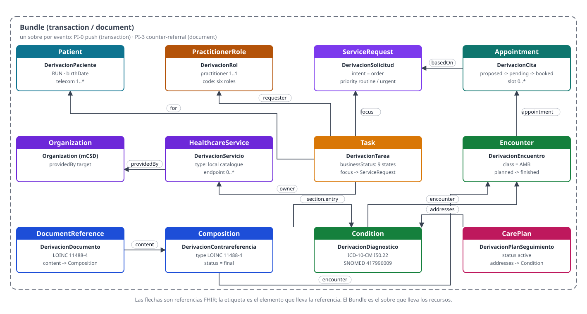

# FHIR Proposal: Derivación APS → especialidad con contrareferencia

Step 4 — FHIR proposal: referral APS → specialty. Use case
`01-use-case-spec.md` (validated 2026-11-19), BPMN
`02-bpmn-model.md` (validated 2026-11-19), entities
`03-entities-data.md` (validated 2026-11-19). Field-by-field
mapping: `04-mapping-table.md`. Pack health-interop-superpowers
v0.39.0. FHIR R4 (4.0.1). Synthetic data only.

## Design decisions

1. **One referral = one request + one workflow record** (spec §8).
   The request is a `ServiceRequest`; the workflow state record is
   a `Task` with `focus` → the ServiceRequest. The state lives in
   the Task, not in the request status; the two are kept consistent
   (`ServiceRequest.status` is a coarse mirror — see the mapping
   table §2). The Task is the centre of the resource graph and the
   first thing every later step reads.
2. **The hub holds state, not clinical detail** (C10). The hub
   stores the Task (state, SLA clocks, loop counts, routing) and
   routes the ServiceRequest and the counter-referral document
   through in transit. It never retains the clinical detail.
3. **The referral and the counter-referral travel differently.**
   The referral travels as resources (`ServiceRequest` + `Task` in
   a transaction Bundle) — it is a workflow exchange, not a
   document. The counter-referral travels as a FHIR document
   (`Composition` first entry of a document Bundle, indexed by a
   `DocumentReference`) — it is a clinical document APS
   acknowledges receipt of, and MHD can carry it.
4. **No `Consent` resource for the referral itself** (Q7). Sharing
   the referral data with the requested specialty is covered by the
   care relationship; no separate consent is requested. No consent
   artifact travels, so BPPC/PCF are set aside (see the IHE review).
5. **Counts are state, exposed by operations.** The decline, chase
   and re-scheduling counts live on the Task as extensions and are
   exposed by the status operation (OP-7) and the offer operations
   (OP-3/OP-4) — the BPMN's data-based gateways read them from the
   workflow record.
6. **Our own profiles.** The guide defines its own profiles
   (`Derivacion*`), built on the FHIR R4 base resources. It does
   not base itself on any other FHIR guide. Associations to other
   guides and IHE profiles are offered below, never assumed.

## Resource choices and rejected alternatives

| Entity (§3) | Chosen resource | Why this one | Rejected alternative and why |
|---|---|---|---|
| 1. Patient | `Patient` | Identity — the resource-choice table's row. | — |
| 2. Referral request | `ServiceRequest` (`intent = order`) | A referral is a request for a service; R4 merged `ReferralRequest` into `ServiceRequest`. | `ReferralRequest` (does not exist in R4); `CarePlan` (a plan, not a request); `Task` alone (the request and the workflow record are different entities, spec §8). |
| 3. Workflow state record | `Task` (`focus` → ServiceRequest) | The resource-choice table's workflow-state row; `businessStatus` carries the case state verbatim. | `ServiceRequest.status` (coarse mirror only — the pack rule: never put accept/reject on the request status; `ServiceRequest` has no `statusReason`); `Flag` (a prospective warning, never workflow state); `EpisodeOfCare` (a longitudinal case tracker — this referral is one request with one workflow record, not an episode container). |
| 4. Triage decision | Task transition + Provenance | The decision IS the workflow transition. | `ClinicalImpression` (an assessment, not a workflow decision); a separate `Task` per decision (one referral = one workflow Task). |
| 5. Appointment (+ Slot) | `Appointment` + `Slot` (+ `Schedule`) | Scheduling — the resource-choice table's row; the full 10-value R4 `AppointmentStatus` covers the offer/confirm/book/no-show chain. | `Encounter` for the offer (an offer is not a visit); `Task` for the booking (the booking is a scheduled slot, not a work item). |
| 6. Specialty encounter | `Encounter` (`class = AMB`) | The attended visit. | `Appointment` alone (the appointment is the booking; the visit is the encounter — the R4 rule: never both at once without a rule, and here the rule is booking = Appointment, visit = Encounter). |
| 7. Counter-referral | `Composition` + `DocumentReference` + `Condition` + `CarePlan` | The return is a clinical document (Composition + DocumentReference) whose computable content is the diagnosis (Condition) and the follow-up plan (CarePlan). | Plain resources only (no document — then MHD cannot carry the return and APS has no document to acknowledge); a CDA document (CDA is out of scope for the pack). |
| 8. Practitioner | `Practitioner` + `PractitionerRole` | The person + the role they hold in this referral (six roles). | `Practitioner` alone (no role — the case's six roles need `PractitionerRole.code`). |
| 9. Organisation / care service | `Organization` + `HealthcareService` + `Location` + `Endpoint` | Exactly the mCSD directory resources. | A local `Location` alone (no service/endpoint — the hub could not route). |
| 10. MPI identity record | `Patient` (MPI's golden record) + PIXm/PMIR transactions | The MPI record is the MPI's Patient; the flow uses the IHE transactions, not a resource exchange. | Exchanging the MPI record as a resource in the referral flow (the MPI key travels on the referral's Patient; the record itself stays in the MPI). |
| 11. Notification | `Communication` (`status = completed`) | A message already sent — the resource-choice table's row. | `CommunicationRequest` (a request that someone communicate — the notification has already been sent); `Task` (a notification is not a work item); `Subscription` alone (a subscription notifies, it does not record a send). |
| 12. Declined-referral record | No FHIR equivalent | Nothing is created and nothing travels. | `Task` / `Communication` (either would invent a referral the case deliberately has none). |
| 13. Cancellation record | Task transition + `Appointment` + `Communication` + `Provenance` | The cancellation IS the transition to `cancelled`. | A separate `Task` per cancellation (one referral = one workflow Task; the cancellation is its terminal transition). |

## Profiles (our own)

Naming: `Derivacion*` (Spanish, as the DAU case's `DAUPaciente` /
`EncuentroUrgenciaAlta`). Base: the FHIR R4 base resource
(canonical URL below). **The user may choose a different base for
any profile** — for example, for `Patient`, `PatientCL` /
`CorePacienteCl` from the Chilean core guide
(`https://hl7chile.cl/fhir/ig/clcore/StructureDefinition/CorePacienteCl`,
package `hl7.fhir.cl.clcore`, latest 1.9.4 — verified resolvable in
prior work). If the user picks a base from another guide, step 5
adds that guide's FHIR package as a dependency and the profile's
`Parent:` is that base; the default is the R4 base resource.

| Profile | Base resource | Canonical URL of the base | Key constraints (summary; full FSH in step 5) |
|---|---|---|---|
| `DerivacionPaciente` | Patient | `http://hl7.org/fhir/StructureDefinition/Patient` | `identifier` 1..* (MPI key + RUN); `telecom` 1..* (contact data required, C12); `name` 1..1; `birthDate` 1..1. |
| `DerivacionSolicitud` | ServiceRequest | `http://hl7.org/fhir/StructureDefinition/ServiceRequest` | `intent = order` (fixed); `subject` 1..1; `code` 1..1 (requested service, local catalogue); `reasonCode` 1..* (SNOMED CT); `priority` 1..1 (`routine` / `urgent`); `requester` 1..1; `authoredOn` 1..1. |
| `DerivacionTarea` | Task | `http://hl7.org/fhir/StructureDefinition/Task` | `focus` 1..1 → ServiceRequest; `for` 1..1 → Patient; `intent = order` (fixed); `businessStatus` 1..1 (local ValueSet `DerivacionEstadoReferencia`); `statusReason` 0..1; SLA + count extensions (see mapping table §3). |
| `DerivacionCita` | Appointment | `http://hl7.org/fhir/StructureDefinition/Appointment` | `basedOn` 1..* → ServiceRequest; `slot` 0..* → Slot; `participant` 1..* (patient + specialist + location); `patientInstruction` 0..1. |
| `DerivacionEncuentro` | Encounter | `http://hl7.org/fhir/StructureDefinition/Encounter` | `class = AMB` (fixed); `subject` 1..1; `basedOn` 1..* → ServiceRequest; `appointment` 0..1; `serviceType` 1..1 (local catalogue). |
| `DerivacionContrareferencia` | Composition | `http://hl7.org/fhir/StructureDefinition/Composition` | `status = final` (fixed at send); `type` = LOINC 11488-4 "Consult note"; `subject` 1..1; `author` 1..1; sections: Diagnosis, Plan, Follow-up indications, Follow-up plan for APS. |
| `DerivacionDocumento` | DocumentReference | `http://hl7.org/fhir/StructureDefinition/DocumentReference` | `status = current` (fixed at send); `type` = LOINC 11488-4; `subject` 1..1; `content.attachment.url` → Composition; `context.related` → ServiceRequest. |
| `DerivacionDiagnostico` | Condition | `http://hl7.org/fhir/StructureDefinition/Condition` | `code` 1..1 (ICD-10-CM + SNOMED CT); `subject` 1..1; `encounter` 1..1; `clinicalStatus = active`; `verificationStatus = confirmed`. |
| `DerivacionPlanSeguimiento` | CarePlan | `http://hl7.org/fhir/StructureDefinition/CarePlan` | `status = active`; `intent = plan` (fixed); `subject` 1..1; `addresses` 1..* → Condition; `activity.reference` → ServiceRequest / Appointment / Task. |
| `DerivacionNotificacion` | Communication | `http://hl7.org/fhir/StructureDefinition/Communication` | `status = completed` (fixed); `basedOn` 1..* → Task; `sender` 1..1; `recipient` 1..*; `sent` 1..1; `medium` 1..* (local channel list). |
| `DerivacionRol` | PractitionerRole | `http://hl7.org/fhir/StructureDefinition/PractitionerRole` | `practitioner` 1..1; `organization` 1..1; `code` 1..* (local ValueSet `DerivacionRol`, six roles). |
| `DerivacionServicio` | HealthcareService | `http://hl7.org/fhir/StructureDefinition/HealthcareService` | `providedBy` 1..1 → Organization; `type` 1..1 (local catalogue); `active` 1..1; `endpoint` 0..* → Endpoint. |

Supporting profiles (no step 3 entity of their own): the guide
uses the R4 base resources for `Provenance`, `Bundle`,
`Subscription`, `Schedule`, `Slot`, `Location`, `Endpoint`,
`AuditEvent` and `AppointmentResponse` without constraining them
into named profiles, except where the mapping table says otherwise
(the Task SLA/count extensions are defined once, in the guide, and
reused by `DerivacionTarea`).

Local ValueSets and code systems (defined in step 5):
`DerivacionEstadoReferencia` (the nine case states),
`DerivacionRol` (six roles), `DerivacionMotivoRechazo`
("missing exam", "wrong specialty", "capacity" + free text),
`DerivacionCanal` (phone / in person / system message),
`DerivacionEspecialidad` (the local specialty/service catalogue,
versioned by the network). No standard catalogue is invented for
any of these — each is recorded as a local code system with its
canonical URL and version.

## Resource graph

Centre: **`Task` (`DerivacionTarea`)** — it carries the workflow
state, and every later step reads it first. The graph is
ClinFHIR/GraphBuilder-style: each node is a resource (profile
name), each arrow is a FHIR reference, labelled with the element
that carries it. The Bundle is the envelope that carries the
resources in the push operations, never the workflow record.



(`04-fhir-proposal-graph.svg`, built by `render_fhir_graph.py` in
this folder — the geometry is the model. Two right-angle
crossings of two edges, no shared segments, no edge through a
node (verified mechanically): "encounter" (Composition →
Encounter) × "encounter" (Condition → Encounter) at (1090,495),
and "encounter" (Composition → Encounter) × "addresses"
(CarePlan → Condition) at (1090,520). The full reference
list is the mapping table; the graph shows the principal
references only. `Provenance` (history → Task), `Slot`/`Schedule`
(Appointment → Slot → Schedule), `Organization` and `Endpoint`
(folded into the HealthcareService node) are carried in the
mapping table, not drawn, to keep the graph readable.)

Why the Task is the centre and not the ServiceRequest: the case's
question at every step is "where does the referral stand?", and
the answer lives in the workflow record — the Task holds the state,
the SLA clocks and the loop counts, and it is the only resource
every point reads first (PI-4 reads nothing else). The
ServiceRequest is the request the work is about (`Task.focus`);
the Encounter is one visit inside the referral, not the referral
itself; the Composition is the return document, not the workflow.
No `EpisodeOfCare` centres this graph: the referral is one request
with one workflow record, not a longitudinal episode container.

## Lifecycle tables

### Task (`DerivacionTarea`) — the referral state machine

One row per case state: state, allowed next states, the operation
that triggers each transition + its PI, and the forbidden
transitions. `Task.status` is the R4 coarse value;
`businessStatus` is the case state verbatim.

| Case state (`businessStatus`) | `Task.status` | Allowed next states (operation + PI) | Forbidden |
|---|---|---|---|
| `requested` | `requested` | `received` (OP-1 route, PI-0); `cancelled` (OP-8, any PI) | Any other state — a referral cannot be accepted, scheduled or completed before it is received. |
| `received` | `received` | `accepted` (OP-2 accept, PI-1); `rejected` (OP-2 reject, PI-1); `cancelled` (OP-8) | `scheduled`, `completed`, `counter-referred`, `no-show` — no appointment before triage. |
| `accepted` | `accepted` | `scheduled` (OP-3/OP-4 book, PI-2); `cancelled` (OP-8) | `completed`, `counter-referred`, `no-show` — no visit before booking. |
| `rejected` | `rejected` | (terminal, after the APS re-triage decision — the re-referral is a NEW Task + ServiceRequest, OP-1, PI-0); `cancelled` (OP-8, before the re-triage decision) | `scheduled`, `completed`, `counter-referred` — a rejected referral never advances; it closes as `rejected` once APS has decided the re-triage outcome (N1). The referral stays `rejected` with the re-triage clock running until APS decides. |
| `scheduled` | `ready` | `completed` (OP-5 encounter finished, PI-2 — the Encounter reached `finished`); `no-show` is NOT a Task transition from here (the no-show lives on the Appointment; the Task moves on the second no-show — see below); `cancelled` (OP-8) | `counter-referred` — no counter-referral before the visit. |
| `completed` | `in-progress` | `counter-referred` (OP-6, PI-3); `cancelled` (OP-8 — only before the counter-referral is sent) | `scheduled`, `accepted` — the visit is done; the only way forward is the counter-referral. |
| `counter-referred` | `completed` | — (terminal) | Every transition — the loop is closed. A correction is a new document version, not a state change. |
| `no-show` | `failed` | — (terminal) | Every transition — the referral closed after the second no-show. A new referral needs a new Task. |
| `cancelled` | `cancelled` | — (terminal, except the one correction path: re-open to the pre-cancellation state with an explicit re-open entry, hub operator only) | Every other transition — a cancelled referral cannot advance; the hub rejects state changes for terminal referrals. |

Time-based terminal condition: the SLA deadlines are not states —
a deadline breach triggers an escalation (hub → specialty + APS,
or hub → APS for the re-triage timeout, or the scheduler's chase
for the confirmation timeout), never a state change. A referral
never closes by timeout alone.

### ServiceRequest (`DerivacionSolicitud`) — coarse mirror

| `ServiceRequest.status` | Allowed next states (operation + PI) | Forbidden |
|---|---|---|
| `draft` | `active` (OP-1 create, PI-0) | Any other state — a draft has not been sent. |
| `active` | `completed` (OP-6, PI-3); `revoked` (OP-8 cancel, terminal `no-show` PI-2, or rejected-closure on the APS re-triage decision, PI-1) | `draft`, `on-hold` — the case has no hold step; a suspension is a cancellation + re-referral, never a hold. |
| `completed` | — (terminal) | Every transition. |
| `revoked` | — (terminal) | Every transition. |

The ServiceRequest mirror is kept consistent with the Task by the
hub: every Task transition that changes the coarse state updates
the ServiceRequest in the same transaction (OP-1, OP-6, OP-8, the
no-show closure, and the rejected-closure on the APS re-triage
decision — the hub revokes the old ServiceRequest in the same
transaction as the Task's terminal `rejected`).

### Appointment (`DerivacionCita`) — the offer/booking chain

| `Appointment.status` | Allowed next states (operation + PI) | Forbidden |
|---|---|---|
| `proposed` | `pending` (OP-3 confirm, PI-2); `cancelled` (OP-3 decline → the offer's appointment is cancelled and the re-offer is a NEW Appointment, PI-2) | `booked` — a proposed appointment is not booked until the patient confirms. |
| `pending` | `booked` (OP-3 book, PI-2); `cancelled` (OP-8, PI-2) | `proposed`, `noshow` — a pending appointment cannot go back to proposed or be a no-show. |
| `booked` | `arrived` (OP-5 attend, PI-2); `noshow` (OP-5 no-show, PI-2); `cancelled` (OP-8, PI-2); `booked` (same Appointment, new Slot — re-scheduling after a pre-attendance conflict, PI-2) | `proposed`, `pending` — a booked appointment does not re-enter the offer loop; a re-scheduled offer after a no-show is a NEW Appointment. |
| `arrived` | `fulfilled` (OP-5 encounter finished, PI-2) | Every other state — arrival leads to the visit. |
| `fulfilled` | — (terminal for this Appointment) | Every transition. |
| `noshow` | (terminal for this Appointment — the re-scheduled offer is a NEW Appointment, `proposed`, OP-4, PI-2) | `booked`, `arrived`, `fulfilled` — a no-show Appointment is never re-used. |
| `cancelled` | — (terminal) | Every transition — a cancelled Appointment is never re-used. |

The Slot returns to `free` on `noshow` and on `cancelled`
(`Slot.status` `busy` → `free`; R4 `SlotStatus`, Required, five
values: `busy | free | busy-unavailable | busy-tentative |
entered-in-error`).

### Encounter (`DerivacionEncuentro`)

| `Encounter.status` | Allowed next states (operation + PI) | Forbidden |
|---|---|---|
| `planned` (created by OP-3 at booking, PI-2) | `in-progress` (OP-5 attend, PI-2); `cancelled` (OP-8 — only before the visit starts) | `finished` — a visit cannot finish before it starts. |
| `in-progress` | `finished` (OP-5 encounter finished, PI-2) | `planned`, `cancelled` — a visit under way cannot be un-started or cancelled (a cancellation after the visit starts is recorded on the Task, not by cancelling the Encounter). |
| `finished` | — (terminal) | Every transition. |

### CarePlan (`DerivacionPlanSeguimiento`) — the follow-up plan

| `CarePlan.status` | Allowed next states (operation + PI) | Forbidden |
|---|---|---|
| `draft` | `active` (OP-6 send, PI-3) | Any other state. |
| `active` | `completed` (APS completes the follow-up, PI-3 follow-up); `revoked` (the specialist withdraws the plan — new version, PI-3) | `draft` — an active plan does not go back to draft. |
| `completed` / `revoked` | — (terminal) | Every transition. A plan update is a new version linked by `replaces` / `basedOn`, never a silent overwrite. |

`Communication` has no lifecycle table: a notification is sent
(`status = completed`) or not sent; the delivery outcome is the
`delivery-outcome` extension. `Condition` has no workflow table
here: its clinical/verification states (`active` / `confirmed`)
do not change in this case.

## Terminology

Terminology server for expansion and validation:
`https://tx.hl7chile.cl/r4` (the server the MINSAL guides use).
SNOMED CT: Chilean edition
(`http://snomed.info/sct/21000325107`), version as reported by
the terminology server at build time (MINSAL guides pin the
version in `Coding.version` / `ValueSet.compose.include.version`,
e.g. `…/version/20260315` — the guide pins the version the server
reports when the IG is built, and records it in the IG; step 5
validation runs against that pinned version). LOINC version as
reported by the server (LOINC 2.73 seen 2026-11-19; the version is
recorded as `Coding.version` / `ValueSet.compose.include.version`
with the version string the server reports — the SNOMED
`…/version/…` pin pattern is not applied to LOINC). UCUM 2.0.1
(as in the R4 UCUM expansion). ICD-10-CM, version as
reported by the server at build time. Chile uses WHO ICD-10, in
which no systolic-specific code exists (I50 has only I50.0 /
I50.1 / I50.9) — the SNOMED CT second coding 417996009 carries
the precise meaning; the ICD-10-CM code below is the worked
example's billable pin, not the Chilean coding.

| Coded element | FHIR element | Terminology | Binding strength (base) | Codes pinned in this proposal |
|---|---|---|---|---|
| Reason for referral | `ServiceRequest.reasonCode` | SNOMED CT | Example | 84114007 "Heart failure (disorder)" — verified live 2026-11-19 (tx.hl7chile.cl SNOMED browser + EVS: current, FSN "Heart failure (disorder)"). Worked example: suspected heart failure (reason) + free-text note (exertional dyspnoea, ankle oedema). |
| Requested service | `ServiceRequest.code` / `performerType`; `HealthcareService.type` | Local specialty/service catalogue | Example (`ServiceRequest.code` is Example-bound) | Local code system, versioned by the network. Worked example: cardiology. |
| Priority | `ServiceRequest.priority` | R4 `RequestPriority` | Required | `routine` / `urgent` — the R4 values cover the case; no local ValueSet. |
| Referral state | `Task.businessStatus` | Local ValueSet `DerivacionEstadoReferencia` | Example (`businessStatus` is Example-bound) | The nine case states (§ Lifecycle tables). |
| Triage decision | `Task.status` | R4 `TaskStatus` | Required | `accepted` / `rejected`. |
| Rejection reason | `Task.statusReason` | Local list `DerivacionMotivoRechazo` | Example (`statusReason` is Example-bound) | "missing exam" / "wrong specialty" / "capacity" + free text. Worked example: "missing echocardiogram". |
| Cancellation reason | `Task.statusReason` | Local list + free text | Example | "patient deceased" + free text. |
| Appointment status | `Appointment.status` | R4 `AppointmentStatus` | Required | The 10 R4 values (verified live 2026-11-19). |
| Patient decision on the offer | `AppointmentResponse.participantStatus` | R4 `ParticipantStatus` | Required | `needs-action` / `accepted` / `declined` / `tentative`. |
| Encounter class | `Encounter.class` | v3 `ActEncounterCode` | Extensible | `AMB` (ambulatory). |
| Diagnosis (counter-referral) | `Condition.code` | ICD-10-CM (primary) + SNOMED CT (second coding) | Example | ICD-10-CM I50.22 "Chronic systolic (congestive) heart failure" — billable 5-character code, matching the worked example (chronic systolic heart failure); I50.2 itself is a non-billable category header (verified 2026-11-19, ICD-10-CM coding references) + SNOMED CT 417996009 "Systolic heart failure" (pack standing ruling, verified in prior audit work). Worked example: heart failure with reduced ejection fraction. |
| Exams / results | `Observation.code` (supportingInfo) | LOINC | Example | ECG: LOINC 11524-6 "EKG study" (Active, v2.72, Order/Observation: Both). NT-proBNP: LOINC 33762-6 "Natriuretic peptide.B prohormone N-Terminal [Mass/volume] in Serum or Plasma" (Active, v2.73, unit pg/mL UCUM; member of the Heart failure tracking panel 55405-5). Other exams use their LOINC codes from the APS laboratory catalogue; candidate codes are not fixed until the terminology server confirms them. |
| Counter-referral document type | `Composition.type` / `DocumentReference.type` | LOINC | Preferred (`Composition.type` is Preferred-bound; `DocumentReference.type` is Preferred-bound) | LOINC 11488-4 "Consult note" (Active, v2.73 — "typically sent to the referring provider when the consultation is completed"); worked example (cardiology): LOINC 34099-2 "Cardiology Consult Note". A Preferred binding may be replaced by a local ValueSet — here the LOINC codes are kept. |
| Referral document type (reference only) | — | LOINC | — | LOINC 57133-1 "Referral Note" (Active, v2.67) is the document type for a referral that travels as a document. In this design the referral travels as resources, not a document — the code is recorded for the document variant (see the IHE review, PI-0). |
| Practitioner role | `PractitionerRole.code` | Local ValueSet `DerivacionRol` | Example | Six roles: APS doctor / APS admin / triage clinician / specialty scheduler / specialist / hub operator. |
| Notification channel | `Communication.medium` | Local list `DerivacionCanal` | Example | phone / in person / system message. |
| Notification category | `Communication.category` | R4 `CommunicationCategory` | Example | `notification`. |
| Delivery outcome | Extension `delivery-outcome` | Local ValueSet | — (extension) | `delivered` / `failed`. |
| Task code | `Task.code` | Local ValueSet | Example | `referral-workflow` (the Task is a referral workflow record). |

## Operations (proposed — full definitions in step 5)

Each operation names its PI, its inputs/outputs, and the IHE
profile(s) that support it (with the link). The guide's own
transactions are never presented as IHE transactions. Full
operation definitions + sequence diagrams belong to step 5; the
operations are proposed here so step 5 can build them.

| # | Operation | PI | What it does (inputs → outputs) | IHE profile(s) |
|---|---|---|---|---|
| OP-1 | Create referral | PI-0 | APS creates the referral: `POST [base]/Bundle` (`type = transaction`: `ServiceRequest` + `Task` [`status = requested`]) → hub validates, routes (`Task.status = received`), forwards to the specialty. Input: the PI-0 minimum data set. Output: the referral identifier + the Task. | Identity sub-step: PIXm ITI-83 (`$ihe-pix`, full if implemented exactly — https://profiles.ihe.net/ITI/PIXm/) and PDQm ITI-78 (full if exact — https://profiles.ihe.net/ITI/PDQm/). Routing lookup: mCSD ITI-90 (full if exact — https://profiles.ihe.net/ITI/mCSD/). The push itself: 360X PCC-55 as pattern only (partial — see the review); no IHE transaction carries a FHIR `ServiceRequest` + `Task` push. |
| OP-2 | Submit triage decision | PI-1 | Specialty records the decision: `PATCH [base]/Task/{id}` (`status = accepted` + `owner` = accepting service/practitioner, or `status = rejected` + `statusReason`) + Provenance → hub forwards the decision to APS (Communication) and APS admin informs the patient. | 360X PCC-56 Referral Decline as pattern only (partial — the reject leg; see the review). The accept leg has no 360X transaction (acceptance is implicit in 360X — the appointment notification PCC-60 implies it). The Task transition itself is the guide's own. |
| OP-3 | Offer / confirm / book appointment | PI-2 | Scheduler finds availability: `GET [base]/Slot?schedule=…&status=free` / Scheduling `$find` (ITI-115) → creates the Appointment (`status = proposed`) + `AppointmentResponse` (`needs-action`) → hub forwards the offer to the patient and notifies the APS admin → patient confirms (`AppointmentResponse.participantStatus = accepted`, Appointment → `pending`) → scheduler books (Scheduling `$book`, ITI-117; Appointment → `booked`, Slot → `busy`) → creates the Encounter (`status = planned`, `appointment` → the Appointment) at booking. | Scheduling ITI-115 `$find` + ITI-117 `$book` (partial — the booking half; the offer/confirm/chase loop is the guide's own — https://profiles.ihe.net/ITI/Scheduling/). 360X PCC-60 Appointment Notification as pattern only (partial — notifies the referral initiator; it is not a booking). |
| OP-4 | Re-offer / re-schedule | PI-2 | Decline → the offer's Appointment goes to `cancelled`; the re-offer is a NEW Appointment (OP-3 again, `offer-number` +1). Pre-attendance conflict → same Appointment, new Slot (Scheduling `$book` modify, ITI-117). No-show → the old Appointment stays `noshow`; the re-scheduled offer is a NEW Appointment through the same confirm/chase loop (N5). | Scheduling ITI-117 `$book` (partial — modify a booked appointment). The re-offer / re-scheduling rules (counts, loop) are the guide's own. |
| OP-5 | Record attendance / no-show | PI-2 | Specialist records attendance: `PATCH Appointment/{id}` (`status = arrived`, then `fulfilled` at encounter end) + `PATCH Encounter/{id}` (`planned` → `in-progress` at attendance, → `finished` at encounter end). No-show: `PATCH Appointment/{id}` (`status = noshow` + `cancelationReason`) + Slot → `free` + Communication to APS; after the second no-show the Task moves to `failed` / `businessStatus = no-show` and the referral closes. | 360X PCC-61 No-show Notification as pattern only (partial — see the review). The attendance recording itself is the guide's own. |
| OP-6 | Submit counter-referral | PI-3 | Specialist sends the return: `POST [base]/Bundle` (`type = document`: Composition first entry + DocumentReference + Condition + CarePlan) → hub routes it to APS → APS acknowledges receipt (`POST Communication`, `basedOn` → Task, `payload.contentReference` → DocumentReference) → Task → `completed` / `businessStatus = counter-referred`. | MHD ITI-65 Provide Document Bundle (full for the document transport leg, if the guide implements ITI-65 exactly with XDS metadata — https://profiles.ihe.net/ITI/MHD/); 360X PCC-57 Referral Outcome as content pattern only (partial — see the review). The Task transition + the acknowledgement are the guide's own. DSUBm ITI-110 (partial — APS subscribes to the counter-referral document becoming available; see the review). |
| OP-7 | Query referral status | PI-4 | APS reads the state: `GET [base]/Task?focus:ServiceRequest.identifier={referral-id}` (or `GET [base]/Task/{id}`) → the Task with `status`, `businessStatus`, `lastModified`, the SLA deadlines and the loop counts, plus `next expected step` (`Task.description`). Read-only; the query never changes state. | **None applies** — no IHE profile carries a workflow-state query (see the review). Plain FHIR search. |
| OP-8 | Cancel referral | Any PI (before completion) | Any party requests cancellation: `PATCH [base]/Task/{id}` (`status = cancelled` + `statusReason`, incl. "patient deceased") + `PATCH Appointment/{id}` (`status = cancelled` + `cancelationReason`) where booked + Slot → `free` + Communication fan-out to APS, patient and specialty + Provenance entry. | 360X PCC-58 Referral Cancellation as pattern only (partial — see the review); Scheduling ITI-117 `$book` (partial — cancels the booked appointment). The Task transition + the fan-out are the guide's own. |
| OP-9 | Resolve patient identity | PI-0 (support) | Before creation: `GET [base]/Patient/$ihe-pix?identifier=…` (PIXm ITI-83) returns the MPI key; or `GET [base]/Patient?family=…&given=…` (PDQm ITI-78) finds the patient by demographics. | PIXm ITI-83 (full if implemented exactly); PDQm ITI-78 (full if implemented exactly). PMIR ITI-93 is the MPI-side feed/merge association (offered, not a PI-0 transaction). |
| OP-10 | Find care service / endpoint | PI-0 (support) | Hub routing lookup: `GET [base]/HealthcareService?type=…&active=true` (+ `Endpoint`) — the directory returns the requested specialty service and its endpoint. | mCSD ITI-90 Find Matching Care Services (full if implemented exactly — https://profiles.ihe.net/ITI/mCSD/). |
| OP-11 | Subscribe to referral state changes | All PIs (support) | A consumer subscribes to Task changes: `POST [base]/Subscription` (`criteria = "Task?focus:ServiceRequest.identifier={referral-id}"`, `channel.type = rest-hook`, `channel.endpoint` = subscriber URL, `channel.payload = application/fhir+json`) → the hub notifies on each Task transition. | **None applies** — a FHIR `Subscription` on a non-document event is the guide's own (DSUB/DSUBm subscribe to document events only). See the review. |
| OP-12 | Notify a state change | All PIs (support) | The hub or a party sends a notification: `POST [base]/Communication` (`status = completed`, `basedOn` → Task, `sender`, `recipient`, `sent`, `medium`, `payload` = the notice) → the recipient's system. The named senders are C5/Q3. | **None applies** for the notification itself — a `Communication` push is the guide's own. (DSUBm ITI-110/111/112 covers document-event notification only — it applies to the counter-referral document becoming available, OP-6, not to state-change notices.) |

Every operation appears in at least one sequence diagram in step
5 (the `sequence-diagrams` skill: one diagram per BPMN flow, each
message naming its operation). The operations above are the
proposal; step 5 defines their exact FHIR interactions, examples
and diagrams.

## IHE review (per interoperability point)

Review run 2026-11-19, each profile verified live at
profiles.ihe.net / ihe.net / wiki.ihe.net, never from memory. It
builds on the step 2 landscape scan (14 profiles, `02-bpmn-model.md`
§ scan): the scan listed candidates; this review decides fit per
point. Fit test: **full** = same actors, same transaction number,
same message semantics and options, same wire format and scope;
**partial** = the pattern coincides but the mechanism is the
guide's own; **none** = the profile's actors/transactions do not
cover the point. A national-guide transaction is never an IHE
transaction; this guide has no national-guide transaction to
confuse with one.

| PI | IHE profile | Fit | Actors / transactions | What is covered and what remains custom |
|---|---|---|---|---|
| PI-0 Referral creation (APS → hub → specialty) | 360X (PCC) Rev. 1.2 Trial Implementation 2021-04-14 — https://www.ihe.net/uploadedFiles/Documents/PCC/IHE_PCC_Suppl_360X.pdf (supplement read live 2026-11-19) | **Partial** (pattern) | Referral Initiator / Referral Recipient; PCC-55 Referral Request (R, both actors). Transport XDM (base) with XDR / MHD options (§X.2.2); content CDA (Referral Note, LOINC 57133-1) or C-CDA. | The pattern coincides: a persistent referral identifier until the loop closes, a referral request with relevant clinical information, and the scope test passes — the patient returns to the referring provider for continued care (360X §X.4.1, verified live). What remains custom: the mechanism. 360X is document-based (CDA referral request over XDM/XDR/MHD) and Trial Implementation; this guide pushes FHIR resources (`ServiceRequest` + `Task`) over FHIR REST. No IHE transaction carries a FHIR `ServiceRequest` + `Task` push. The guide implements the 360X pattern (identifier, closed loop, return to referrer) with its own transaction (OP-1). |
| PI-0 (identity sub-step) | PIXm (ITI) v3.1.0 Publication, FHIR R4 — https://profiles.ihe.net/ITI/PIXm/ (scan, checked 2026-11-19) | **Full** (if implemented exactly) | Patient Identifier Cross-reference Consumer / Manager / Source; ITI-83 Mobile Patient Identifier Cross-reference Query (`GET [base]/Patient/$ihe-pix`); ITI-104 Patient Identity Feed. | Full for the MPI-key resolution: same actors, same transaction, same FHIR REST wire format. The guide's OP-9 implements ITI-83 exactly. The matching rules that decide a merge are local MPI policy, never in the profile. |
| PI-0 (identity sub-step) | PDQm (ITI) v3.2.0 Publication, FHIR R4 — https://profiles.ihe.net/ITI/PDQm/ (scan, checked 2026-11-19) | **Full** (if implemented exactly) | Patient Demographics Consumer / Supplier; ITI-78 Mobile Patient Demographics Query (GET/POST Patient search, required for the Supplier); ITI-119 Patient Demographics Match (`Patient.$match`, optional). | Full for the demographics search (OP-9): same actors, same transaction. ITI-119 is `$match`, not a plain search — the guide uses ITI-78 for the search and ITI-119 only where duplicate-candidate matching is needed. |
| PI-0 (routing sub-step) | mCSD (ITI) v4.0.0 Publication, FHIR R4 — https://profiles.ihe.net/ITI/mCSD/ (scan, checked 2026-11-19) | **Full** (if implemented exactly) | Care Services Selective Consumer / Care Services Directory; ITI-90 Find Matching Care Services (Required for the Directory); ITI-91 Request Care Services Updates and ITI-130 Care Services Feed (Optional for the Directory). | Full for the routing lookup (OP-10): the hub finds the requested specialty service (Organization / HealthcareService / PractitionerRole / Location / Endpoint) with ITI-90. The guide implements ITI-90; ITI-91/ITI-130 are optional and not claimed. mCSD finds directory entries — it does not carry a CareTeam (never cite it for care-team membership). |
| PI-0 (workflow pattern) | XBeR-WD (PCC) Trial Implementation — https://wiki.ihe.net/index.php/Cross-enterprise_Basic_eReferral_Workflow_Definition (checked live 2026-11-19) | **Partial** (pattern) | Referral Requester / Referral Scheduler / Referral Performer (XDW Content Creator / Consumer / Updater groupings); three tasks: Request Referral, Schedule Referral (optional), Perform Referral; built on XDW, in an XDS.b context. | The pattern coincides: the eReferral workflow is three tasks tracking request → schedule → perform, with a Workflow Document recording task creation and history. What remains custom: XBeR-WD is a document-based workflow definition (XDW Workflow Document over XDS.b), Trial Implementation; this guide tracks state in a FHIR `Task`. The guide follows the XBeR-WD task shape (request / schedule / perform) with its own Task mechanics. XBeR-WD tracks workflow state; it is not the referral transactions themselves — those are 360X PCC-55–61. Compose the two, never present one as the other. |
| PI-0 (workflow pattern) | XDW (ITI) — ITI TF Vol. 1 ch. 30, https://profiles.ihe.net/ITI/TF/Volume1/ch-30.html (scan, checked 2026-11-19) | **Partial** (pattern) | Content Creator / Content Consumer / Content Updater; grouped with XDS / XDM / XDR actors for transport. | The generic platform XBeR-WD is built on: a Workflow Document recording task creation and history with references to input/output documents. Same cap as XBeR-WD — document-based, not FHIR. The guide's Task is the FHIR-native equivalent. |
| PI-0 (document variant) | MHD (ITI) v4.2.5 Publication, FHIR R4 — https://profiles.ihe.net/ITI/MHD/ (scan, checked 2026-11-19) | **None** (as designed) | Document Source / Document Recipient / Document Consumer / Document Responder; ITI-65 Provide Document Bundle, ITI-105 Simplified Publish, ITI-66/67 Find/Retrieve Document Lists and References, ITI-68 Retrieve Document, ITI-106 Generate Metadata. | None for PI-0 as designed: the referral travels as `ServiceRequest` + `Task` resources, not as a document, so there is no document to provide. Offered as an association: if a deployment sends the referral as a document Bundle (Composition with LOINC 57133-1 "Referral Note"), MHD ITI-65 carries it (partial — the document leg; the workflow state stays the guide's own). XDS.b is the classic alternative for the same document variant (ITI-41/42/18/43, Final Text) — same cap, SOAP/ebXML instead of FHIR REST. |
| PI-1 Accept / reject (specialty → hub → APS) | 360X (PCC) Rev. 1.2 TI 2021-04-14 (supplement read live 2026-11-19) | **Partial** (pattern, reject leg only) | Referral Recipient / Referral Initiator; PCC-56 Referral Decline (R for the Initiator receiving; O for the Recipient sending — "Send Decline of Referral Request", with the reason). | The reject leg coincides: the specialty declines with a reason (PCC-56 carries the reason for the decline). What remains custom: the mechanism (CDA document over XDM/XDR/MHD vs the guide's Task transition + Communication) and the accept leg — 360X has no "accept" transaction. Acceptance is implicit in 360X (the appointment notification PCC-60 implies it); in this guide acceptance is an explicit Task transition (`accepted` + `owner`), because scheduling may not start without it. The guide implements the PCC-56 pattern (decline + reason) with its own transaction (OP-2). |
| PI-1 (workflow pattern) | XBeR-WD / XDW (as PI-0) | **Partial** (pattern) | As PI-0. | The triage decision is the "Request Referral" task completing in the XBeR-WD shape; the state tracking is the guide's Task. Same cap as PI-0. |
| PI-1 | MHD / XDS.b | **None** | — | The decision is a workflow transition, not a document. No document travels at PI-1. |
| PI-2 Scheduling (specialty ↔ patient, via hub) | Scheduling (ITI) v1.0.0 Publication, FHIR R4, Active 2024-12-12 — https://profiles.ihe.net/ITI/Scheduling/ (scan, checked 2026-11-19) | **Partial** | Scheduling Client / Scheduling Server; ITI-115 Find Potential Appointments (`$find`), ITI-116 Hold Appointment (`$hold`, optional), ITI-117 Book Appointment (`$book` — books a new appointment, modifies a booked appointment, or cancels a booked/held appointment), ITI-118 Search Patient Appointments. | The booking half coincides: the scheduler finds availability (ITI-115), holds a slot (ITI-116, optional) and books it (ITI-117), and APS can search the patient's appointments (ITI-118). What remains custom: the offer/confirm/chase/re-offer/no-show loop. Scheduling has no publish/notify transaction — ITI-115/116/117/118 are client-initiated find/hold/book/search only; the server never pushes a schedule change. The offer to the patient, the 3-working-day confirmation wait, the chases, the one re-offer, the re-scheduling counts and the no-show closure are the guide's own (OP-3/OP-4/OP-5). A schedule publication is partial-by-pull (ITI-118 search); any push/fan-out notification is the guide's own Communication. |
| PI-2 (notification) | 360X PCC-60 Appointment Notification; PCC-61 No-show Notification (supplement read live 2026-11-19) | **Partial** (pattern) | Referral Recipient → Referral Initiator; PCC-60 (O, "Notification of an appointment scheduled by the Referral Recipient") and PCC-61 (O, "Notification that the patient did not show up for a scheduled appointment"). | The notification pattern coincides: the specialty notifies the referral initiator of the appointment (PCC-60) and of the no-show (PCC-61). What remains custom: the mechanism (document-based, optional transactions) and the audience — PCC-60/61 notify the Referral Initiator (APS); the patient-facing offer and the APS-admin notification of the offer are the guide's own Communications. Compose Scheduling ITI-117 (the booking) with 360X PCC-60 (the notification to the referral initiator); never present PCC-60 as the booking itself. |
| PI-2 | XBeR-WD "Schedule Referral" task | **Partial** (pattern) | As PI-0. | The scheduling phase is the optional "Schedule Referral" task in the XBeR-WD shape; the booking mechanics are Scheduling + the guide's own loop. Same cap as PI-0. |
| PI-3 Counter-referral return (specialty → hub → APS) | MHD (ITI) v4.2.5 Publication, FHIR R4 — https://profiles.ihe.net/ITI/MHD/ (scan, checked 2026-11-19) | **Partial** (document leg full) | Document Source / Document Recipient / Document Consumer / Document Responder; ITI-65 Provide Document Bundle (Optional for the Document Source, Required for the Document Recipient), ITI-66/67 Find/Retrieve Document Lists and References, ITI-68 Retrieve Document, ITI-105 Simplified Publish, ITI-106 Generate Metadata. | The document transport leg is full if the guide implements ITI-65 exactly: OP-6 posts a document Bundle (Composition first entry + DocumentReference + Condition + CarePlan) with XDS metadata generated via ITI-106. What remains custom: the workflow half — the Task transition to `counter-referred` and the APS receipt acknowledgement (Communication) are the guide's own; MHD carries documents, not workflow state. Overall PI-3 is partial: a full document leg inside a custom workflow. |
| PI-3 (content pattern) | 360X PCC-57 Referral Outcome (supplement read live 2026-11-19) | **Partial** (pattern) | Referral Recipient → Referral Initiator; PCC-57 (R, "Contains the outcome of the services performed according to the referral request"). | The content pattern coincides: the specialist returns the outcome of the referral to the initiator, closing the loop. What remains custom: the mechanism (CDA outcome document over XDM/XDR/MHD vs the guide's FHIR document Bundle) and the acknowledgement (APS receipt acknowledgement is the guide's own Communication). The guide implements the PCC-57 pattern (outcome closes the loop) with its own transaction (OP-6). |
| PI-3 (availability) | DSUBm (ITI) v1.0.0 Publication, FHIR R4 — https://profiles.ihe.net/ITI/DSUBm/ (scan, checked 2026-11-19) | **Partial** | Resource Notification Subscriber / Broker / Publisher / Recipient; ITI-110 Resource Subscription, ITI-111 Resource Publish, ITI-112 Resource Notify, ITI-113 Resource Subscription Search, ITI-114 SubscriptionTopic Search. | Partial for the availability half: APS subscribes (ITI-110) to the counter-referral document becoming available (a document event — DSUBm subscribes to document events only) and is notified (ITI-112). The document retrieval itself is MHD ITI-67/68; the Task transition is the guide's own. DSUBm never carries referral state changes (Task status), which are not document events. |
| PI-3 (workflow pattern) | XBeR-WD "Perform Referral" task / XDW (as PI-0) | **Partial** (pattern) | As PI-0. | The consultation and its report are the "Perform Referral" task in the XBeR-WD shape; the document mechanics are MHD + the guide's own Task. Same cap as PI-0. |
| Any PI — cancellation (before completion) | 360X (PCC) Rev. 1.2 TI 2021-04-14 (supplement read live 2026-11-19) | **Partial** (pattern) | Referral Initiator → Referral Recipient; PCC-58 Referral Cancellation ("Sent from the Referral Initiator to the Referral Recipient"). | The cancellation pattern coincides: a referral cancellation notice closes the loop. Direction cap: PCC-58 travels Initiator → Recipient only, while this case allows the specialty or the patient to initiate a cancellation (OP-8) — those legs are the guide's own Communication fan-out. The Task transition + the fan-out are the guide's own. |
| PI-4 Status query (APS → hub) | — | **None applies** | — | No IHE profile carries a workflow-state query. QEDm PCC-44 covers clinical data elements only (its 10 options: Simple Observations, Allergies and Intolerances, Conditions, Diagnostic Reports, Medications, Immunizations, Procedures, Encounters, Provenance, Occupational Data for Health — 0 mentions of Task, Appointment or ServiceRequest status on the PCC-44 page, v3.0.0); a Task search is plain FHIR search, never QEDm. DSUBm covers document events only, not Task status. XDW/XBeR-WD track workflow state in a shared Workflow Document — they define no query transaction for the current state (the requester queries and retrieves the Workflow Document itself, which is a document retrieval, not a status query). The guide's OP-7 is plain FHIR search on the Task (`GET Task?focus:ServiceRequest.identifier=…`). This is an explicit none, not a gap to force a fit into. |
| All PIs (cross-cutting) | ATNA (ITI) Final Text, ITI TF Vol. 1 ch. 9 — https://profiles.ihe.net/ITI/TF/Volume1/ch-9.html (scan, checked 2026-11-19) | Cross-cutting (not a per-PI fit) | Authenticate Node [ITI-19], Record Audit Event [ITI-20]; RESTful ATNA supplement Trial Implementation (ITI-81 Retrieve ATNA Audit Event, ITI-82 Retrieve Syslog Event). | Audit and node authentication for every exchange: each operation records an `AuditEvent`. The FHIR `AuditEvent` feed/query via RESTful ATNA is Trial Implementation. ATNA applies to every point as the audit/security layer, not to any single PI. |
| All PIs (cross-cutting) | CT (ITI) Final Text, ITI TF Vol. 1 ch. 7 — https://wiki.ihe.net/index.php/CT (scan, checked 2026-11-19) | Cross-cutting (not a per-PI fit) | Consistent Time Client / Server; NTP-based synchronisation, median error under 1 second. | Consistent time across the network for every timestamped event (SLA clocks, audit times, `authoredOn`, `lastModified`). CT applies to every point as infrastructure, not to any single PI. |
| (set aside) | BPPC (ITI) Final Text, ITI TF Vol. 1 ch. 19 (scan, checked 2026-11-19) | **Set aside** | Patient privacy consents for document sharing (CDA-based). | No consent artifact travels — the referral is covered by the care relationship (spec §4, Q7). Its FHIR successor PCF is set aside for the same reason. |
| (set aside) | QEDm PCC-44 for PI-4 (see the PI-4 row) | **Set aside for workflow state** | — | QEDm is the clinical-data pull for the exams inside the referral (the APS clinical summary, the counter-referral's diagnosis as a Condition query) — it is not the status query. Where a consumer pulls the referral's clinical elements (diagnosis, exams), QEDm PCC-44 applies with its options (Encounters, Diagnostic Reports, Simple Observations) — partial as written, full only if PCC-44 + the options are implemented exactly. |

**Fit summary:** full 3 (PIXm ITI-83, PDQm ITI-78, mCSD ITI-90 —
each for a sub-step, if implemented exactly); partial 13 — 13 rows
in the table above, across 6 distinct partially-fitting profiles
(360X, XBeR-WD, XDW, Scheduling, MHD, DSUBm): 360X PCC-55/56/57/58/
60/61 as pattern, XBeR-WD/XDW as pattern, Scheduling ITI-115/116/
117/118 for the booking half, MHD ITI-65 for the PI-3 document
leg, DSUBm ITI-110 for the document availability; none 1 (PI-4,
the status query — explicit). No
point is carried end-to-end by an IHE profile: the referral
workflow itself (state machine, SLA clocks, loop counts, chase
and re-offer rules) is the guide's own `Task` mechanics in every
point.

## Gaps and risks

| # | Gap / risk | Severity | Mitigation |
|---|---|---|---|
| G1 | No IHE profile carries the referral workflow end-to-end (state machine, SLA clocks, counts). A deployment that expects 360X or XBeR-WD conformance will find only a pattern match. | Medium | The review states the fit honestly per point; the guide documents the 360X/XBeR-WD pattern relationship and offers the associations (below) instead of claiming conformance. |
| G2 | Identity matching: the MPI key travels with the referral, but a patient with two MPI keys (duplicate enrolment) resolves only if the MPI merges them (PMIR ITI-93). A referral created under the retired key must still resolve. | Medium | The MPI keeps both local identifiers linked to the surviving key (`Patient.link type = replaced-by`); the hub updates the workflow record on an identity feed (§10). Step 6 tests the merge-after-creation path. |
| G3 | The Task extensions (SLA deadlines, decline/chase/re-scheduling counts) are guide-local. Another implementation reading the Task sees the R4 `status` but not the case state unless it reads `businessStatus` and the extensions. | Low | `businessStatus` carries the case state in a published local ValueSet; the extensions are defined once in the guide with canonical URLs. Step 5 documents them as must-support. |
| G4 | `Appointment.status = pending` vs `proposed`: the R4 definitions are close ("none" vs "some or all" of the participants have finalized acceptance) and implementers may collapse them. | Low | The guide pins the transition rule (offer = `proposed`; patient confirmed = `pending`; slot held = `booked`) in the lifecycle table, and the patient's decision is authoritative on the `AppointmentResponse`, not on the Appointment. |
| G5 | The counter-referral document (MHD ITI-65) requires XDS metadata (ITI-106) for registry submission; a deployment without a registry can post the document Bundle directly but cannot claim ITI-65. | Low | OP-6 defines the direct post as the base case and the ITI-65 + ITI-106 registry submission as the offered association (below). |
| G6 | Audit: a blocked disclosure is `AuditEvent.outcome = 4` + `outcomeDesc` — R4 has no `denied` outcome value. An implementer inventing `denied` breaks validation. | Low | Recorded in the mapping table (supporting resources) and the terminology table; step 5 validation runs the FHIR validator on the examples. |
| G7 | The local specialty/service catalogue and the rejection-reason list are network-maintained; a service missing from the catalogue is a creation-time validation failure, not a hub hold (§9). If the catalogue drifts, referrals fail at creation. | Low | The hub re-reads the directory on each routing decision; the catalogue is versioned and its version travels in the guide. |

## Associations offered (not assumed)

The user picks which associations the guide takes. A profile the
user did not choose is documented as a relationship, not claimed
as conformance.

| Association | What it would change | What it costs |
|---|---|---|
| Declare conformance to PIXm (ITI-83) + PDQm (ITI-78) for OP-9 | The identity resolution becomes an IHE-conformant transaction instead of the guide's own search; the MPI must expose `$ihe-pix` and the Patient search exactly as the profiles require. | The MPI must implement ITI-83/ITI-78; the guide's Patient search is already the same shape, so the cost is conformance testing, not redesign. |
| Declare conformance to mCSD (ITI-90) for OP-10 | The directory lookup becomes an IHE-conformant transaction. | The directory must expose ITI-90; the guide's lookup is already the same shape. |
| Declare conformance to Scheduling (ITI-115/116/117/118) for the PI-2 booking half | The booking becomes an IHE-conformant transaction set; the offer/confirm/chase loop stays the guide's own and is documented as such. | The specialty scheduler must implement `$find` / `$hold` / `$book` exactly (ITI-116 `$hold` is optional — the guide may skip it). |
| Declare conformance to MHD (ITI-65) for the PI-3 document leg | The counter-referral post becomes an IHE-conformant document submission (with XDS metadata via ITI-106); APS retrieval becomes ITI-67/68. | A Document Registry / Recipient must exist; the guide's document Bundle is already the ITI-65 shape, so the cost is the registry + metadata, not redesign. |
| Document 360X / XBeR-WD as a pattern relationship (no conformance) | The guide's closed loop is traceable to the 360X message pattern (PCC-55–61) and the XBeR-WD task shape (request / schedule / perform) in the guide's conformance statement. | Documentation only; no new actors. Recommended — it costs nothing and makes the design reviewable against the IHE referral pattern. |
| Base `DerivacionPaciente` on `CorePacienteCl` (Chilean core) | The Patient profile's `Parent:` becomes `CorePacienteCl`; the guide adds the `hl7.fhir.cl.clcore` package as a dependency. | The package must resolve at build time (it does — latest 1.9.4, verified in prior work); the profile must satisfy the Chilean core constraints (e.g. RUN identifier). Offered, not assumed — the default stays the R4 base Patient. |

## Examples (synthetic)

One minimal valid example per resource lives beside the proposal
in step 5 (`05-implementation-guide/examples/`); the two centre
resources are shown here in short form (synthetic identifiers and
dates from the worked example — María González, 58, RUN
11.111.111-1, CESFAM Los Aromos → cardiology, suspected heart
failure). The `http://derivacion.example.org/fhir/` canonical in
the examples below is the placeholder fixed to the real guide
canonical in step 5.

```json
// DerivacionSolicitud — the referral request (PI-0)
{
  "resourceType": "ServiceRequest",
  "meta": { "profile": ["http://derivacion.example.org/fhir/StructureDefinition/DerivacionSolicitud"] },
  "identifier": [{ "system": "http://aps.losaromos.example.org/referral", "value": "REF-2026-0001" }],
  "status": "active",
  "intent": "order",
  "code": { "coding": [{ "system": "http://derivacion.example.org/fhir/CodeSystem/especialidad", "code": "cardiologia", "display": "Cardiology" }] },
  "subject": { "reference": "Patient/maria-gonzalez" },
  "encounter": { "reference": "Encounter/aps-2026-11-19" },
  "authoredOn": "2026-11-19T09:30:00-03:00",
  "requester": { "reference": "PractitionerRole/aps-doctor" },
  "performerType": { "coding": [{ "system": "http://derivacion.example.org/fhir/CodeSystem/especialidad", "code": "cardiologia" }] },
  "reasonCode": [{ "coding": [{ "system": "http://snomed.info/sct", "code": "84114007", "display": "Heart failure (disorder)" }], "text": "Suspected heart failure: exertional dyspnoea, ankle oedema" }],
  "priority": "routine",
  "supportingInfo": [{ "reference": "Observation/ecg-2026-11-19" }, { "reference": "Observation/ntprobnp-2026-11-19" }]
}
```

```json
// DerivacionTarea — the workflow state record (PI-0, centre)
{
  "resourceType": "Task",
  "meta": { "profile": ["http://derivacion.example.org/fhir/StructureDefinition/DerivacionTarea"] },
  "identifier": [{ "system": "http://aps.losaromos.example.org/referral", "value": "REF-2026-0001" }],
  "status": "requested",
  "businessStatus": { "coding": [{ "system": "http://derivacion.example.org/fhir/CodeSystem/estado-referencia", "code": "requested" }] },
  "intent": "order",
  "code": { "coding": [{ "system": "http://derivacion.example.org/fhir/CodeSystem/task-code", "code": "referral-workflow" }] },
  "focus": { "reference": "ServiceRequest/ref-2026-0001" },
  "for": { "reference": "Patient/maria-gonzalez" },
  "authoredOn": "2026-11-19T09:30:00-03:00",
  "lastModified": "2026-11-19T09:30:00-03:00",
  "requester": { "reference": "PractitionerRole/aps-doctor" },
  "description": "acceptance decision"
}
```

The SLA deadlines and loop counts travel as the extensions
defined in the mapping table (§3); the examples above show the
Task at creation (no deadlines set yet beyond the derived
acceptance deadline — the hub sets the extensions when it receives
the referral). All examples are synthetic and validate against
their profiles in step 5 (FHIR validator).

## Done when (step 4 checklist)

- [x] Every entity maps to exactly one resource, chosen from the
  resource-choice table (mapping table; §12 is the honest "no FHIR
  equivalent", §4/§13 are Task transitions, not separate resources).
- [x] Every interoperability point names its IHE profile (or "none
  applies"), with actors and transactions verified live (IHE review
  table above; PI-4 is an explicit none).
- [x] The base resource for each profile is stated with its
  canonical URL, and the user was offered a different one (profile
  table + associations).
- [x] Every resource with a workflow state has a lifecycle table
  (Task, ServiceRequest, Appointment, Encounter, CarePlan).
- [x] The resource graph centres on the workflow-state resource
  (Task) and names its centre and why.
- [x] All examples are synthetic (worked example, synthetic RUN
  and dates; full examples validate in step 5).
