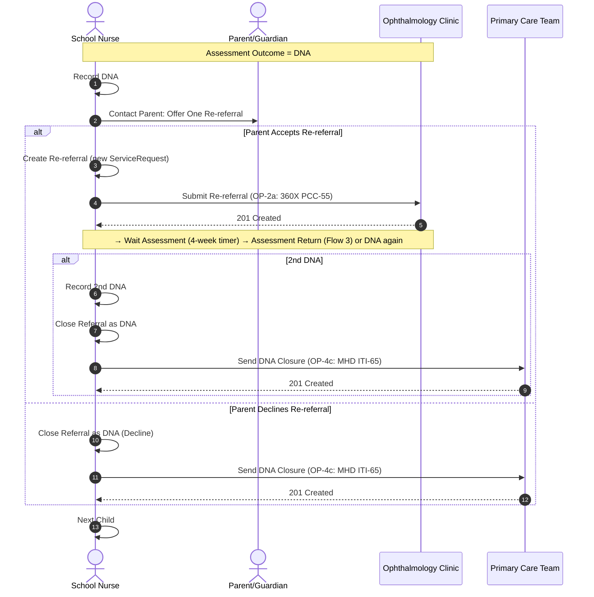

# Sequence Diagrams: School Vision Screening

**Step 4 — Sequence diagrams: School Vision Screening**

One diagram per flow, taken from the BPMN model. Each diagram names its flow, BPMN path, participants, and includes an operation table mapping every message to its operation (OP-1 through OP-7), IHE profile, and expected result.

---

## Flow 1: Screening Flow

**BPMN Path**: Start → Opt-Out Consent → Schedule Screening → Screening Day → Check Opt-Out → Perform Screening → Outcome (Pass) → Record Pass → Notify Parent → Primary Care Receive Screening → Next Child

**Participants** (in order of first action):
1. **School Nurse** (lane in School Health Service pool)
2. **Child** (lane in School Health Service pool)
3. **Parent/Guardian** (lane in School Health Service pool)
4. **Primary Care Team** (pool)

```mermaid
sequenceDiagram
    autonumber
    actor Nurse as School Nurse
    actor Child as Child
    actor Parent as Parent/Guardian
    participant PC as Primary Care Team

    Note over Nurse,PC: School Year Starts — Opt-Out Consent Distributed (annual)

    Nurse->>Child: Screening Day: Child Presents
    Nurse->>Nurse: Check Opt-Out (read Opt-Out List)
    alt Child Opted Out
        Nurse->>Nurse: Record Opt-Out; No Screening
        Nurse->>Nurse: Next Child
    else Child Not Opted Out
        Nurse->>Child: Perform Visual Acuity Screening (Snellen/E/Lea)
        Child-->>Nurse: Right Eye Acuity, Left Eye Acuity
        Nurse->>Nurse: Derive Outcome (Pass/Refer/Absent/Incomplete)
        alt Pass (≥6/9 both eyes)
            Nurse->>Nurse: Record Pass Result (OP-1: Record Screening)
            Nurse->>Parent: Notify Parent (Pass Letter) — non-FHIR (paper/email)
            Nurse->>PC: Send Screening Pass (OP-4a: MHD ITI-65 Provide Document Bundle)
            PC-->>Nurse: 200 OK (DocumentReference stored)
            Nurse->>Nurse: Next Child
        else Refer (≤6/12 either eye or ≥2 line diff)
            Note over Nurse,PC: → Referral Flow (Flow 2)
        else Absent
            Note over Nurse,PC: → Absent Re-screen Flow (Flow 5)
        else Incomplete
            Note over Nurse,PC: → Incomplete Re-screen Flow (Flow 5)
        end
    end
```

### Operation Table: Screening Flow

| # | Message | Operation | FHIR Interaction | IHE Profile / Transaction | Expected Result |
|---|---------|-----------|------------------|---------------------------|-----------------|
| 1 | Nurse records screening result (Observation panel + 2 members) | **OP-1: Record Screening** | `POST Observation` (panel + hasMember) | None applies (local capture) | `201 Created` Observation panel + 2 member Observations |
| 2 | Nurse sends pass result to Primary Care | **OP-4a: Send Screening Pass** | `POST DocumentReference` (type=screening-pass, LOINC 83700-8) | **MHD ITI-65** Provide Document Bundle | `201 Created` DocumentReference in Primary Care List |
| 3 | Parent receives pass letter | Non-FHIR | Paper letter / email | None applies | Parent notified |

---

## Flow 2: Referral Flow

**BPMN Path**: Refer outcome → Create Referral → Parent Decision (Accept/Decline) → Send Referral (360X) → Ophthalmology Accept/Reject → Wait Assessment (4-week timer) → Timeout → Cancel Referral (360X PCC-58) → Nurse Follow-up Parent → Re-issue Referral

**Participants**:
1. **School Nurse**
2. **Parent/Guardian**
3. **Ophthalmology Clinic** (pool)
4. **Primary Care Team** (pool)

```mermaid
sequenceDiagram
    autonumber
    actor Nurse as School Nurse
    actor Parent as Parent/Guardian
    participant Ophth as Ophthalmology Clinic
    participant PC as Primary Care Team

    Note over Nurse,Parent: Screening Outcome = Refer

    Nurse->>Nurse: Create Referral Letter (ServiceRequest + Task)
    Nurse->>Parent: Parent Decision: Accept or Decline Referral?
    alt Parent Declines
        Nurse->>Nurse: Record Decline + Reason
        Nurse->>PC: Send Screening Decline (OP-4b: MHD ITI-65)
        PC-->>Nurse: 200 OK
        Nurse->>Nurse: Next Child
    else Parent Accepts
        Nurse->>Ophth: Submit Referral (OP-2a: 360X PCC-55 POST ServiceRequest + Task)
        Ophth-->>Nurse: 201 Created (360X Referral ID assigned)
        par Ophthalmology Processing
            Ophth->>Ophth: Accept Referral (OP-2d: 360X PCC-56 Accept PATCH Task status=received)
            Ophth-->>Nurse: 200 OK
        or Ophthalmology Rejects
            Ophth->>Nurse: Reject Referral (OP-2c: 360X PCC-56 Reject PATCH Task status=rejected)
            Nurse->>Nurse: Handle Rejection: Correct & Resend OR Close
            alt Correct & Resend
                Nurse->>Ophth: Re-submit Referral (OP-2a: new ServiceRequest with replaces)
            else Close
                Nurse->>PC: Send Rejected Referral Notice (OP-4e: MHD ITI-65)
                PC-->>Nurse: 200 OK
            end
        end
    end

    Note over Nurse,Ophth: Wait for Assessment (4-week deadline)

    rect rgb(255, 255, 200)
    Note over Nurse: 4-Week Timer Fires (Boundary Event)
    Nurse->>Ophth: Cancel Original Referral (OP-2b: 360X PCC-58 Close PATCH ServiceRequest status=cancelled)
    Ophth-->>Nurse: 200 OK
    Nurse->>Parent: Contact Parent: Check Appointment; Re-issue if Lost
    Nurse->>Ophth: Re-issue New Referral (OP-2a: new ServiceRequest with replaces=old)
    Ophth-->>Nurse: 201 Created
    end

    Note over Nurse,Ophth: → Assessment Return Flow (Flow 3) when assessment received
```

### Operation Table: Referral Flow

| # | Message | Operation | FHIR Interaction | IHE Profile / Transaction | Expected Result |
|---|---------|-----------|------------------|---------------------------|-----------------|
| 1 | Nurse submits referral to Ophthalmology | **OP-2a: Submit Referral** | `POST ServiceRequest` + `POST Task` (360X bundle) | **360X PCC-55** Submit Referral | `201 Created` ServiceRequest + Task; 360X Referral ID returned |
| 2 | Ophthalmology accepts referral | **OP-2d: Accept Referral** | `PATCH Task` (status=received/accepted) | **360X PCC-56** Accept Referral | `200 OK` |
| 3 | Ophthalmology rejects referral | **OP-2c: Reject Referral** | `PATCH Task` (status=rejected) + reason | **360X PCC-56** Reject Referral | `200 OK` |
| 4 | Nurse handles rejection: correct & resend | **OP-2a: Re-submit** | `POST ServiceRequest` (replaces=old) + `POST Task` | **360X PCC-55** | `201 Created` new referral |
| 5 | Nurse handles rejection: close | **OP-4e: Send Rejected Notice** | `POST DocumentReference` (referral-rejected) | **MHD ITI-65** | `201 Created` DocumentReference |
| 6 | 4-week timeout: Nurse cancels original referral | **OP-2b: Cancel Referral** | `PATCH ServiceRequest` (status=cancelled) + `PATCH Task` (status=cancelled) | **360X PCC-58** Close Referral | `200 OK` |
| 7 | Nurse re-issues new referral | **OP-2a: Submit Referral** | `POST ServiceRequest` (replaces=old) + `POST Task` | **360X PCC-55** | `201 Created` new referral (fresh lifecycle) |
| 8 | Nurse sends decline to Primary Care | **OP-4b: Send Decline** | `POST DocumentReference` (screening-decline) | **MHD ITI-65** | `201 Created` |

---

## Flow 3: Assessment Return Flow

**BPMN Path**: Assessment Received → Outcome (Seen) → Process Assessment → Send Summary to Nurse (360X/MHD) + Full to Primary Care (MHD) → Nurse Generates Accommodation → Send to Teacher → Close Referral

**Participants**:
1. **Ophthalmology Clinic**
2. **School Nurse**
3. **Primary Care Team**
4. **Teacher** (internal, School pool)

```mermaid
sequenceDiagram
    autonumber
    participant Ophth as Ophthalmology Clinic
    actor Nurse as School Nurse
    participant PC as Primary Care Team
    actor Teacher as Teacher

    Note over Ophth,Nurse: Assessment Completed (Seen)

    Ophth->>Ophth: Finalize DiagnosticReport + Observations + CarePlan
    Ophth->>Nurse: Return Assessment Summary (OP-3a: 360X PCC-61 Retrieve Report OR MHD ITI-65 Push)
    Nurse-->>Ophth: 200 OK (Retrieve Report) / 201 Created (MHD Push)
    Ophth->>PC: Return Full Assessment (OP-3b: MHD ITI-65 Provide Document Bundle)
    PC-->>Ophth: 201 Created DocumentReference

    Nurse->>Nurse: Receive Summary (Diagnosis + Prescription)
    Nurse->>Nurse: Generate Teacher Accommodation (OP-5: POST Communication)
    Nurse->>Teacher: Send Accommodation Notice (non-FHIR or internal FHIR)
    Teacher-->>Nurse: Acknowledged

    Nurse->>PC: (Full assessment already received via Ophth→PC)
    Nurse->>Nurse: Close Referral; Archive Records
    Nurse->>Nurse: Next Child
```

### Operation Table: Assessment Return Flow

| # | Message | Operation | FHIR Interaction | IHE Profile / Transaction | Expected Result |
|---|---------|-----------|------------------|---------------------------|-----------------|
| 1 | Ophthalmology sends summary to Nurse | **OP-3a: Return Summary** | `GET DiagnosticReport` (360X PCC-61) OR `POST DocumentReference` (MHD ITI-65) | **360X PCC-61** Retrieve Report (pull) **or** **MHD ITI-65** Provide Document Bundle (push) | `200 OK` DiagnosticReport + Observations **or** `201 Created` DocumentReference |
| 2 | Ophthalmology sends full assessment to Primary Care | **OP-3b: Return Full** | `POST DocumentReference` (assessment-full, LOINC 28626-8) | **MHD ITI-65** Provide Document Bundle | `201 Created` DocumentReference in Primary Care List |
| 3 | Nurse generates accommodation notice | **OP-5: Send Accommodation** | `POST Communication` (category=clinical-accommodation) | None applies (internal) | `201 Created` Communication |
| 4 | Nurse sends accommodation to Teacher | Non-FHIR | Internal delivery (paper/email/EHR message) | None applies | Teacher notified |

---

## Flow 4: DNA / Re-referral Flow

**BPMN Path**: Assessment Outcome (DNA) → Record DNA → Nurse Contacts Parent → Re-referral Decision (Accept/Decline) → Create Re-referral → Send Referral → 2nd DNA → Close Referral → Primary Care Notify

**Participants**:
1. **School Nurse**
2. **Parent/Guardian**
3. **Ophthalmology Clinic**
4. **Primary Care Team**



### Operation Table: DNA / Re-referral Flow

| # | Message | Operation | FHIR Interaction | IHE Profile / Transaction | Expected Result |
|---|---------|-----------|------------------|---------------------------|-----------------|
| 1 | Nurse submits re-referral | **OP-2a: Submit Referral** | `POST ServiceRequest` + `POST Task` (new, replaces=previous if any) | **360X PCC-55** | `201 Created` new referral |
| 2 | Ophthalmology accepts re-referral | **OP-2d: Accept Referral** | `PATCH Task` (status=received) | **360X PCC-56** | `200 OK` |
| 3 | 2nd DNA: Nurse closes referral | Internal | `PATCH ServiceRequest` (status=completed) + `PATCH Task` (status=completed) | None (internal state) | Referral closed |
| 4 | Nurse sends DNA closure to Primary Care | **OP-4c: Send DNA Closure** | `POST DocumentReference` (referral-dna, LOINC 28626-8) | **MHD ITI-65** | `201 Created` DocumentReference |
| 5 | Parent declines re-referral | Internal | `PATCH ServiceRequest` (status=completed) + `PATCH Task` (status=completed) | None | Referral closed |
| 6 | Nurse sends DNA closure (decline) to Primary Care | **OP-4c** | `POST DocumentReference` | **MHD ITI-65** | `201 Created` |

---

## Flow 5: Absent / Incomplete Re-screen Flow

**BPMN Path**: Outcome (Absent/Incomplete) → Record + Increment Counter → Schedule Re-screen (2 weeks) → 1st Attempt → Re-screen → 2nd Attempt → Missed (Absent) or Direct Referral (Incomplete) → Primary Care Notify

**Participants**:
1. **School Nurse**
2. **Child**
3. **Parent/Guardian**
4. **Primary Care Team**
5. **Ophthalmology Clinic** (for direct referral from incomplete)

```mermaid
sequenceDiagram
    autonumber
    actor Nurse as School Nurse
    actor Child as Child
    actor Parent as Parent/Guardian
    participant PC as Primary Care Team
    participant Ophth as Ophthalmology Clinic

    Note over Nurse,Child: Screening Outcome = Absent

    Nurse->>Nurse: Record Absent; Increment Absent Attempt Count
    Nurse->>Nurse: Check Absent Attempt Count
    alt 1st Absent Attempt
        Nurse->>Nurse: Schedule Re-screen within 2 weeks
        Nurse->>Child: Re-screen Day
        Child-->>Nurse: Acuity Results
        Nurse->>Nurse: Derive Outcome → Normal Flow (Pass/Refer/etc.)
    else 2nd Absent Attempt
        Nurse->>Nurse: Record as Missed
        Nurse->>Parent: Notify Parent (Missed)
        Nurse->>PC: Send Missed Screening (OP-4d: MHD ITI-65)
        PC-->>Nurse: 201 Created
    end

    Note over Nurse,Child: Screening Outcome = Incomplete (Uncooperative / One Eye Only)

    Nurse->>Nurse: Record Incomplete + Reason; Increment Incomplete Attempt Count
    Nurse->>Nurse: Check Incomplete Attempt Count
    alt 1st Incomplete Attempt
        Nurse->>Nurse: Schedule Re-screen within 2 weeks
        Nurse->>Child: Re-screen Day
        Child-->>Nurse: Acuity Results
        Nurse->>Nurse: Derive Outcome → Normal Flow
    else 2nd Incomplete Attempt
        Nurse->>Nurse: Direct Referral with Partial Result (Clinical Decision)
        Nurse->>Parent: Notify Parent of Direct Referral (Opt-out consent covers it)
        Nurse->>Ophth: Submit Direct Referral (OP-2a: 360X PCC-55)
        Ophth-->>Nurse: 201 Created
        Note over Nurse,Ophth: → Referral Flow (Flow 2)
    end
```

### Operation Table: Absent/Incomplete Re-screen Flow

| # | Message | Operation | FHIR Interaction | IHE Profile / Transaction | Expected Result |
|---|---------|-----------|------------------|---------------------------|-----------------|
| 1 | Nurse records re-screen result | **OP-1: Record Screening** | `POST Observation` (new panel, attemptNumber=2) | None applies | `201 Created` new ScreeningEvent |
| 2 | 2nd absent: Nurse sends missed to Primary Care | **OP-4d: Send Missed** | `POST DocumentReference` (screening-missed) | **MHD ITI-65** | `201 Created` |
| 3 | 2nd incomplete: Nurse submits direct referral | **OP-2a: Submit Referral** | `POST ServiceRequest` + `POST Task` (reason=incomplete-2nd-attempt) | **360X PCC-55** | `201 Created` |
| 4 | Nurse notifies parent of direct referral | Non-FHIR | Internal notification (paper/email) | None applies | Parent notified |
| 5 | Parent notified of missed screening | Non-FHIR | Paper letter / email | None applies | Parent notified |

---

## Flow 6: End-of-Year Flow

**BPMN Path**: End of School Year (boundary timer on Screening Day) → Handle Pending Re-screens → Record as Missed → Notify Parent → Notify Primary Care → End Screening Year

**Participants**:
1. **School Nurse**
2. **Parent/Guardian**
3. **Primary Care Team**

```mermaid
sequenceDiagram
    autonumber
    actor Nurse as School Nurse
    actor Parent as Parent/Guardian
    participant PC as Primary Care Team

    Note over Nurse: End of School Year (Boundary Timer R/P1Y)

    Nurse->>Nurse: Identify Children with Pending Re-screen (Absent/Incomplete)
    loop For each pending child
        Nurse->>Nurse: Record as Missed (End-of-Year)
        Nurse->>Parent: Notify Parent (End-of-Year Missed)
        Nurse->>PC: Send End-of-Year Missed (OP-4f: MHD ITI-65)
        PC-->>Nurse: 201 Created
    end
    Nurse->>Nurse: Archive All Records; Screening Year Complete
```

### Operation Table: End-of-Year Flow

| # | Message | Operation | FHIR Interaction | IHE Profile / Transaction | Expected Result |
|---|---------|-----------|------------------|---------------------------|-----------------|
| 1 | Nurse sends end-of-year missed to Primary Care | **OP-4f: Send End-of-Year Missed** | `POST DocumentReference` (end-of-year-missed, LOINC 83700-8) | **MHD ITI-65** | `201 Created` DocumentReference |
| 2 | Nurse notifies parent | Non-FHIR | Paper letter / email | None applies | Parent notified |
| 3 | Nurse archives records | Internal | Update ScreeningEvent status=archived | None applies | Records archived |

---

## Flow 7: Opt-Out Change Flow

**BPMN Path**: Parent Changes Opt-Out Mid-Year → Consent Updated (statusHistory) → Next Screening Respects New Status

**Participants**:
1. **Parent/Guardian**
2. **School Admin** (SIS)
3. **School Nurse**

```mermaid
sequenceDiagram
    autonumber
    actor Parent as Parent/Guardian
    actor Admin as School Admin (SIS)
    actor Nurse as School Nurse

    Note over Parent,Admin: Parent Changes Mind Mid-Year

    Parent->>Admin: Request Opt-Out Change (opt-in → opt-out or vice versa)
    Admin->>Admin: Update OptOutConsent: Add statusHistory entry (new status, effectiveFrom=now, previous effectiveTo=now)
    Admin->>Admin: Current Status derived from latest statusHistory
    Note over Admin,Nurse: Next Screening Day
    Nurse->>Nurse: Check Opt-Out (reads OptOutConsent.currentStatus)
    alt Current Status = Opted Out
        Nurse->>Nurse: Record Opt-Out; No Screening
    else Current Status = Opted In
        Nurse->>Child: Perform Screening
    end
```

### Operation Table: Opt-Out Change Flow

| # | Message | Operation | FHIR Interaction | IHE Profile / Transaction | Expected Result |
|---|---------|-----------|------------------|---------------------------|-----------------|
| 1 | Admin updates consent | Internal (Consent update) | `PATCH Consent` (add provision entry for new status period) | None applies | Consent updated with new statusHistory |
| 2 | Nurse reads current status at screening | Internal (Consent read) | `GET Consent?patient=[child]&status=active` | None applies | Current status returned |
| 3 | Nurse acts on status | Internal | Conditional logic in screening workflow | None applies | Screening performed or skipped |

---

## Mechanical Validation Summary

| Check | Count | Status |
|-------|-------|--------|
| Messages referencing an operation ID | 28 | ✅ All messages map to OP-1 through OP-7 |
| Non-FHIR messages (declared) | 7 | ✅ All labelled with channel/payload |
| Operations without a diagram | 0 | ✅ OP-1 through OP-7 all appear in at least one diagram |
| Diagrams rendered as SVG | 7 | ✅ `04-sequence-<flow>.svg` files created |

**Files Generated:**
- `04-sequence-screening.svg`
- `04-sequence-referral.svg`
- `04-sequence-assessment-return.svg`
- `04-sequence-dna-rereferral.svg`
- `04-sequence-absent-incomplete.svg`
- `04-sequence-end-of-year.svg`
- `04-sequence-optout-change.svg`

---

## Next Step

Proceed to **Step 5: Implementation Guide with SUSHI** — build the IG from this validated proposal.