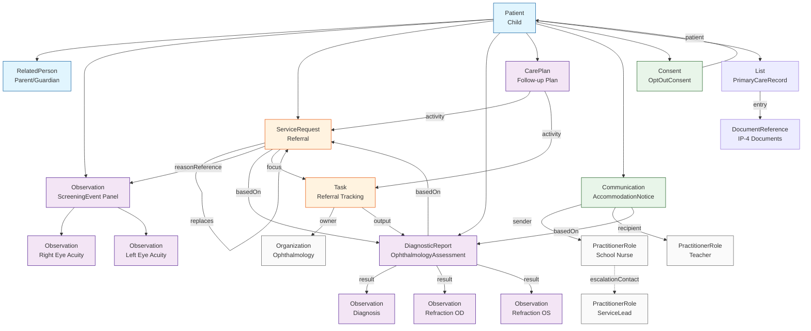

# Resource Diagram

---

## Resource Graph

The following diagram shows the FHIR resource relationships for the School Vision Screening workflow.

*Click to view full-size. Use scroll/zoom controls.*

---

## Graph Structure

**Centre Resource**: `ServiceRequest` (Referral) / `Task` (Referral Tracking)

**Why**: The referral is the central workflow object that coordinates across all three organisations (School, Ophthalmology, Primary Care). It carries the lifecycle state (Draft → Sent → Accepted/Rejected/Cancelled → Completed/Closed-*) and links to all other resources.

---

## Resource Relationships

| From Resource | To Resource | Relationship | Cardinality | FHIR Path |
|---------------|-------------|--------------|-------------|-----------|
| `Patient` (Child) | `Observation` (ScreeningEvent Panel) | Has screening | 1 : 0..N per year | `Observation.subject` |
| `Patient` | `ServiceRequest` (Referral) | Has referral | 1 : 0..N | `ServiceRequest.subject` |
| `Patient` | `DiagnosticReport` (Assessment) | Has assessment | 1 : 0..1 | `DiagnosticReport.subject` |
| `Patient` | `Consent` (OptOut) | Has consent | 1 : 1 per year | `Consent.patient` |
| `Patient` | `Communication` (Accommodation) | Has accommodation | 1 : 0..N | `Communication.subject` |
| `Patient` | `List` (PrimaryCareRecord) | Has document log | 1 : 1 | `List.subject` |
| `Observation` (Panel) | `Observation` (Right Eye) | Has member | 1 : 1 | `Observation.hasMember` |
| `Observation` (Panel) | `Observation` (Left Eye) | Has member | 1 : 1 | `Observation.hasMember` |
| `Observation` (Panel) | `ServiceRequest` | Triggers referral | 1 : 0..1 | `ServiceRequest.reasonReference` |
| `ServiceRequest` | `ServiceRequest` (prev) | Replaces | 0..1 : 0..1 | `ServiceRequest.replaces` |
| `ServiceRequest` | `Task` | Tracked by | 1 : 1 | `Task.focus` |
| `ServiceRequest` | `DiagnosticReport` | Results in | 1 : 0..1 | `DiagnosticReport.basedOn` |
| `DiagnosticReport` | `Observation` (Diagnosis) | Contains result | 1 : 1 | `DiagnosticReport.result` |
| `DiagnosticReport` | `Observation` (Refraction OD) | Contains result | 1 : 1 | `DiagnosticReport.result` |
| `DiagnosticReport` | `Observation` (Refraction OS) | Contains result | 1 : 1 | `DiagnosticReport.result` |
| `DiagnosticReport` | `CarePlan` | Has follow-up plan | 1 : 1 | `CarePlan.activity.detail` |
| `DiagnosticReport` | `Communication` | Generates accommodation | 1 : 1 | `Communication.basedOn` |
| `ServiceRequest` | `DocumentReference` (IP-4) | Notifies primary care | 1 : 1..N | `DocumentReference.context.related` |
| `DiagnosticReport` | `DocumentReference` (IP-4) | Updates primary care | 1 : 1 | `DocumentReference.context.related` |
| `PractitionerRole` (Nurse) | `PractitionerRole` (Lead) | Escalates to | N : 1 | `PractitionerRole.extension(escalationContact)` |

---

## Resource Summary Table

| Resource | Profile | Count per Child per Year | Workflow State | Key Extensions |
|----------|---------|--------------------------|----------------|----------------|
| `Patient` | `SVSPatient` | 1 | — | `gradeAtScreening`, `schoolYear` |
| `RelatedPerson` | `SVSRelatedPerson` | 1+ | — | `optOutStatus`, `optOutEffectiveFrom/To` |
| `Practitioner` + `PractitionerRole` | `SVSPractitioner` / `SVSPractitionerRole` | 3-5 (nurse, lead, ophthalmologist, teacher, admin) | — | `escalationContact` |
| `Observation` (Panel) | `SVSObservationScreeningPanel` | 1-3 (initial + re-screens) | `registered → final/amended/corrected` | `hasMember` → 2 member Observations |
| `Observation` (Right/Left Eye) | `SVSObservationRight/LeftEyeAcuity` | 2 per panel | `final/amended/corrected` | `valueRatio` (Snellen), `bodySite` (right/left eye) |
| `ServiceRequest` | `SVSServiceRequestReferral` | 0..N | `draft → active → completed/cancelled/rejected` | `replaces`, `expectedDeadline`, `parentDecision` |
| `Task` | `SVSTaskReferralTracking` | 1 per referral | `requested → received/accepted/rejected → completed/cancelled` | `restriction.period.end` (4-week deadline) |
| `DiagnosticReport` | `SVSDiagnosticReportAssessment` | 0..1 per referral | `registered → final/amended/corrected/appended` | `basedOn` → ServiceRequest |
| `Observation` (Diagnosis) | `SVSObservationDiagnosis` | 1 per assessment | `final/amended/corrected` | `bodySite` (right/left eye) |
| `Observation` (Refraction) | `SVSObservationRefractionOD/OS` | 2 per assessment | `final/amended/corrected` | `component` (sphere/cylinder/axis) |
| `CarePlan` | `SVSCarePlanFollowUp` | 1 per assessment | `active → completed` | `activity.detail.scheduledPeriod` |
| `Communication` | `SVSCommunicationAccommodation` | 0..N | `sent → completed` | `accommodationType`, `validUntil`, `assessmentReference` |
| `Consent` | `SVSConsentOptOut` | 1 per year | `active → inactive` | Multiple `provision` entries for statusHistory |
| `DocumentReference` | `SVSDocumentReferenceIP4` | 6 per child per year | `current/superseded` | `context.related` → ServiceRequest |
| `List` | `SVSListPrimaryCareDocuments` | 1 per child | `current` | `entry` → DocumentReference |

---

## Centre Resource Justification

The **`ServiceRequest` (Referral) / `Task` (Tracking)** pair is the centre of the resource graph because:

1. **Workflow State Carrier**: The referral lifecycle (Draft → Sent → Accepted/Rejected/Cancelled → Completed/Closed-*) drives the entire inter-organisational workflow
2. **Cross-Organisation Coordination**: Links School (requester), Ophthalmology (performer/owner), and Primary Care (recipient of outcomes)
3. **Traceability Hub**: All clinical data flows connect through the referral:
   - ScreeningEvent → `reasonReference`
   - Assessment → `basedOn`
   - Primary Care documents → `context.related`
4. **360X Alignment**: Directly implements the 360X Closed Loop Referral profile (PCC-55/56/58/61)

This is not a longitudinal `EpisodeOfCare` (the screening is annual, not continuous care management) and not a `Patient`-centred graph alone (the workflow spans three organisations).